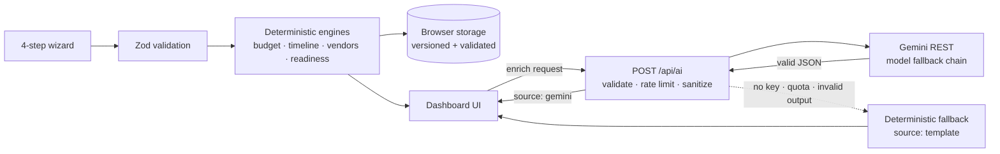

<div align="center">

# 🎉 Festora AI

### Plan every celebration, beautifully.

**A GenAI-powered planning assistant for weddings, birthdays and community events.**
Deterministic budgets and timelines you can trust, plus grounded Gemini creativity you can enjoy.

[](https://festora-ai-navy.vercel.app/)

[](https://github.com/ajx1tech/festora-ai/actions)


[Live demo](https://festora-ai-navy.vercel.app/) · [Challenge alignment](#-challenge-alignment) · [Features](#-features) · [Architecture](#-how-it-works) · [Run locally](#-getting-started) · [Roadmap](#-roadmap)

<br />


</div>

---

## ✨ Overview

Planning a wedding, a birthday or a community festival means juggling a budget, dozens of deadlines and a long list of vendors, usually in spreadsheets and chat threads.

**Festora AI turns a 4-step questionnaire into a complete, living plan:**

- ⚡ **Instantly**, with no AI call, it builds a balanced budget, a backwards-scheduled timeline, a vendor checklist and a readiness score.
- 🤖 **Optionally**, it asks Google Gemini for a personalised concept, ideas, vendor messages, invitations, a run-of-show, and a chat assistant that knows your real numbers.

> **Design principle:** deterministic engines own every number and date. Gemini owns language and creativity, and it is never allowed to invent figures. If AI is unavailable, the app falls back to template content and labels it honestly.

### 🚀 Try it in 30 seconds

1. Open the **[live demo](https://festora-ai-navy.vercel.app/)**.
2. Click **Try a sample wedding** (or pick the birthday or community sample).
3. Explore the tabs: Budget, Timeline, Vendors, AI Ideas, Invitations, Ask Festora.

No account and no sign-up are needed. Your plans stay in your browser.

---

## 🎯 Challenge alignment

**Challenge 5, Celebration & Event Planner:** *"Create a GenAI-powered planning assistant that helps users organize weddings, birthdays, and community events with budgets, timelines, vendor checklists, and personalized ideas."*

| Challenge requirement | How Festora AI delivers it | Code |
|---|---|---|
| **Weddings, birthdays, community events** | Three event types, each with its own task templates, budget categories, vendors and tone. Weddings: 24 tasks and 10 budget categories. Birthdays: 16 and 8. Community festivals: 18 and 9 (permits, volunteers, safety, AV). | [`lib/engines`](lib/engines) |
| **Budgets** | Largest-remainder allocation so categories always sum **exactly** to the total. Lock and rebalance lines, track expenses, per-guest cost, and what-if sliders. | [`lib/engines`](lib/engines) |
| **Timelines** | Backwards scheduling from the event date, grouped by phase. A **compressed mode** kicks in for short-notice events. Export to `.ics`. | [`lib/engines`](lib/engines) |
| **Vendor checklists** | Status pipeline (researching, contacted, quoted, booked, paid), per-category "questions to ask", and quotes that flow into the budget. | [`components/dashboard`](components/dashboard) |
| **Personalised ideas** | Gemini concepts, themes, ideas and saving tips shaped by your vibe, dietary needs, traditions, priorities and budget per guest. | [`lib/ai`](lib/ai), [`app/api/ai`](app/api/ai) |
| **GenAI-powered assistant** | Plan-aware chat, vendor outreach drafts, multilingual invitations and a day-of run-of-show. | [`components/ai`](components/ai) |

---

## 🧩 Features

### 🧮 Deterministic planning (no AI required)
- **Smart Budget Engine:** exact-sum allocations, a contingency buffer, lock-and-rebalance, expense tracking and a what-if simulator.
- **Backwards Timeline:** phase-grouped milestones, overdue and critical flags, and automatic compression for events under 30 days away.
- **Vendor Tracker:** status pipeline, quotes, notes and a "questions to ask" checklist per category.
- **Readiness Score (0 to 100):** weighs task progress, critical vendor bookings, budget health and schedule slack, and surfaces actionable alerts.
- **Sample events:** a wedding, a birthday and a community mela, loadable in one click and always relative to today's date.

### 🤖 Grounded GenAI (Gemini)
- **AI Ideas:** a concept, 3 themes, 8 ideas with cost bands, and saving tips. One click adds an idea to your timeline.
- **Vendor outreach:** WhatsApp-ready messages that include your real date, guest count and the right questions.
- **Invitations:** formal, playful or heartfelt tones in English, Hindi and Marathi.
- **Run of Show:** a timed schedule for the event day.
- **Ask Festora:** a chat assistant fed a compact, non-sensitive summary of *your* plan, so it answers "Am I over budget?" with your actual numbers.

### 🎨 Experience
- Light and dark themes, event-specific accent colours, and a responsive layout for mobile and desktop.
- Calendar (`.ics`), JSON and print/PDF export.
- Every AI result carries an honest source badge: **Gemini** or **Smart template**.

---

## 📸 Screenshots

<table>
  <tr>
    <td width="50%"><br /><sub><b>Guided wizard:</b> validated inputs and a short-notice warning</sub></td>
    <td width="50%"><br /><sub><b>Overview:</b> readiness score, alerts and next actions</sub></td>
  </tr>
  <tr>
    <td width="50%"><br /><sub><b>Budget:</b> exact-sum allocation, locks and what-if</sub></td>
    <td width="50%"><br /><sub><b>Timeline:</b> backwards-scheduled, phase-grouped tasks</sub></td>
  </tr>
  <tr>
    <td width="50%"><br /><sub><b>AI Ideas:</b> personalised concept and one-click "Add to plan"</sub></td>
    <td width="50%"><br /><sub><b>Ask Festora:</b> chat grounded in your plan data</sub></td>
  </tr>
</table>

<div align="center">
  <br />
  <sub><b>Mobile and dark mode</b></sub>
</div>

---

## ⚙️ How it works

Festora AI is built as a **hybrid system**. A deterministic core produces the plan, and the AI layer only enriches it.



### The deterministic core

| Engine | What it guarantees |
|---|---|
| **Budget** | Allocated amounts sum **exactly** to the total (largest-remainder rounding). Rebalancing preserves the total, respects locks and never goes negative. |
| **Timeline** | No task is ever dated after the event. Short-notice events switch to a **compressed schedule** that keeps task order and flags critical items. |
| **Vendors** | Booked and paid quotes feed committed spend in the budget. |
| **Readiness** | Bounded 0 to 100. More completed work never lowers the score. Alerts are rule-based and explainable. |
| **Calendar export** | RFC 5545-compliant `.ics` with escaped text, folded lines and reminders for critical tasks. |

All engines are **pure TypeScript functions** with no React, no network access and an injected clock, so they are fully deterministic and unit-tested.

### 🧠 Smart assistant behaviours

- **Compressed scheduling:** short-notice events get a re-planned timeline instead of overdue tasks on day one.
- **Context-aware alerts:** for example, "venue not booked with under 60 days left", overspend per category, and overdue critical tasks, each with a suggested action.
- **Grounded chat:** the assistant only receives a compact plan summary and is instructed to use only the numbers it is given.
- **Honest fallbacks:** when AI is unavailable, the UI instantly shows template content labelled **Smart template**, never a silent failure and never a fake "Gemini" badge.

---

## 🤖 GenAI usage

**Provider:** Google Gemini API (free-tier Flash models). **Default chain:** `gemini-3.8-flash` → `gemini-3.5-flash-lite` → `gemini-3.1-flash-lite`, configurable via `GEMINI_MODELS`.

Gemini is called **server-side only**, through plain REST `fetch` in the `/api/ai` route (no SDK), so the API key never reaches the browser.

| Task | What Gemini does | How it is constrained |
|---|---|---|
| **Ideas** | Concept, 3 themes, 8 ideas with cost bands, saving tips | JSON output validated with Zod, one repair retry, then template fallback |
| **Vendor message** | Drafts a concise outreach message | Uses only supplied event facts and catalog questions |
| **Invitation** | Two variants in the chosen tone and language | Language and tone are enumerated inputs |
| **Run of show** | Timed event-day schedule | Validated structure, template fallback |
| **Ask Festora** | Answers planning questions | Grounded in a compact plan summary, with a length cap and an off-topic refusal |

### 🛡️ Failure handling

| Situation | Behaviour |
|---|---|
| `GEMINI_API_KEY` missing | Template content is returned and labelled **Smart template**. |
| Model not found, 429, 5xx or timeout | Automatically tries the next model in the chain (12 s timeout per attempt). |
| Invalid or fenced JSON | Fences are stripped, then one repair request is made, then the fallback is used. |
| 401 or 403 | Not retried. Reported as AI unavailable and the fallback is used. |
| Rate limit exceeded | HTTP 429 with `Retry-After`, shown in the UI as a countdown. |
| Corrupt browser storage | Zod validation rejects it and the app starts clean without crashing. |

---

## 🛠️ Tech stack

| Layer | Technology |
|---|---|
| Framework | Next.js 16 (App Router), React 19 |
| Language | TypeScript (strict) |
| Styling | Tailwind CSS 4, CSS-variable design tokens, `next/font` |
| UI primitives | Radix UI (Tabs, Dialog, Slider), lucide-react, custom SVG charts |
| Validation | Zod 4 (forms, API requests, AI output, stored data) |
| AI | Google Gemini API via REST `fetch` (server-side) |
| State | React Context + `useReducer`, persisted to `localStorage` |
| Testing | Jest 30, React Testing Library, user-event, jest-axe |
| Quality | ESLint 9, Prettier, GitHub Actions CI |
| Hosting | Vercel |
| Built with | Google Antigravity (Gemini 3.1 Pro) |

---

## 🔒 Security

- **Server-side secrets:** `GEMINI_API_KEY` exists only in server code and environment variables. It is never in the client bundle, logs, responses or the repo.
- **Strict CSP and headers:** `connect-src 'self'` (the browser never talks to Google directly), plus `frame-ancestors 'none'`, `object-src 'none'`, `X-Content-Type-Options`, `Referrer-Policy`, `Permissions-Policy` and HSTS, configured in `next.config.ts`.
- **Input validation everywhere:** Zod schemas on every API request with strict length limits and a request-body size cap. AI output and `localStorage` data are validated before use.
- **Prompt-injection hardening:** user text is stripped of tags and control characters, wrapped in explicit data delimiters, and the model is told never to treat it as instructions or to invent figures.
- **Safe rendering:** all AI text is rendered as plain text through React. There is no `dangerouslySetInnerHTML`.
- **Abuse protection:** per-client sliding-window rate limit (20 requests per 10 minutes), with generic error messages that never expose upstream details.
- **Privacy by design:** plans live in your browser. Only a compact, non-sensitive plan summary is sent when you use an AI feature.

## ♿ Accessibility

- **Semantic structure:** landmarks, a correct heading order and a **skip-to-content** link.
- **Forms:** every control has a label, hints and errors linked with `aria-describedby`, and focus moves to each wizard step heading.
- **Live updates:** `aria-live` regions announce AI status, budget rebalancing and chat messages.
- **Contrast:** colour tokens are checked against a **4.5:1** ratio by an automated test in light and dark themes.
- **Not colour alone:** alerts, overspend and critical tasks use icons and text as well as colour. Charts have text-table fallbacks.
- **Keyboard and motion:** full keyboard operation, visible focus rings, dialog focus traps, 44px touch targets and `prefers-reduced-motion` support.
- **Automated checks:** `jest-axe` runs against the main screens.

---

## 🧪 Testing & quality gates

```bash
npm run validate        # typecheck + lint + tests + production build
npm run test:coverage   # Jest with the coverage report
```

| Suite | Covers |
|---|---|
| **Engines** | Budget invariants (exact sums, locks, rebalancing), timeline ordering and compression, readiness bounds, ICS format, fallback content, colour contrast |
| **AI layer** | Model fallback chain, timeouts, JSON repair, template fallback, prompt sanitization, rate limiter |
| **API route** | Validation errors, payload limits, 429 with `Retry-After`, no secret or upstream leakage |
| **Components** | Wizard validation, dashboard tabs, vendor and budget flows, AI tabs with mocked responses |
| **Accessibility** | `jest-axe` checks on the main screens |

**GitHub Actions** runs typecheck, lint, tests with coverage and a production build on every push and pull request. No step is allowed to fail silently, and the code base uses no `eslint-disable`, `@ts-ignore` or build-error suppression.

---

## 🚀 Getting started

### Prerequisites
- Node.js 20+ and npm 10+
- *(Optional, for live AI)* a free Gemini API key from [Google AI Studio](https://aistudio.google.com/)

### Setup

```bash
git clone https://github.com/ajx1tech/festora-ai.git
cd festora-ai
npm install
cp .env.example .env.local     # Windows PowerShell: Copy-Item .env.example .env.local
npm run dev
```

Open <http://localhost:3000>.

### Environment variables

| Variable | Required | Description |
|---|---|---|
| `GEMINI_API_KEY` | For live AI | Server-only Gemini key. **Never** prefix it with `NEXT_PUBLIC_`. |
| `GEMINI_MODELS` | No | Comma-separated model fallback chain. Default: `gemini-3.8-flash,gemini-3.5-flash-lite,gemini-3.1-flash-lite` |

> 💡 **The app works without a key.** Budget, timeline, vendors and readiness are fully deterministic, and AI features fall back to templates.
>
> 💡 Create your key in an AI Studio project that is **not** linked to a billing account to stay on the free tier. Free-tier prompts may be reviewed by Google, so don't enter sensitive personal data.
>
> 💡 Model IDs change over time. If you see "Smart template" with a valid key, check your available models and update `GEMINI_MODELS`.

### Useful scripts

| Command | Purpose |
|---|---|
| `npm run dev` | Start the dev server |
| `npm run build` / `npm start` | Production build and serve |
| `npm run typecheck` | `tsc --noEmit` |
| `npm run lint` | ESLint |
| `npm test` / `npm run test:coverage` | Jest, with or without coverage |
| `npm run format` / `format:check` | Prettier |
| `npm run validate` | The full quality gate |

---

## ☁️ Deployment (Vercel)

1. Push the repository to GitHub and **import it in [Vercel](https://vercel.com/)**. The Next.js preset is detected automatically.
2. Add `GEMINI_API_KEY` (and optionally `GEMINI_MODELS`) under **Settings → Environment Variables**.
3. Deploy. Every push to `main` redeploys automatically. Environment variable changes apply on the next deployment.

**Health check:** `GET /api/health` returns `{ status, aiConfigured, models }` with no secrets, which is useful for confirming AI is wired up.

---

## 📁 Project structure

```text
festora-ai/
├── app/
│   ├── api/ai/            # Server-side Gemini route (validation, rate limit, fallback)
│   ├── api/health/        # Non-secret AI status endpoint
│   └── planner/           # Dashboard, 4-step wizard, print view
├── components/
│   ├── ai/                # Ideas, invitations, run-of-show, vendor message, chat
│   ├── dashboard/         # Overview, Budget, Timeline, Vendors, export
│   ├── landing/           # Marketing page sections
│   ├── ui/                # Accessible design-system primitives
│   └── wizard/            # Event creation steps
├── lib/
│   ├── engines/           # Pure deterministic logic (budget, timeline, vendors, readiness, ICS)
│   ├── ai/                # Gemini client, prompts, JSON repair, rate limiter, orchestrator
│   ├── domain/            # Zod schemas and shared types
│   ├── store/             # Context + reducer + validated persistence
│   └── utils/ , a11y/     # Formatting, sanitization, contrast helpers
├── __tests__/             # Jest, React Testing Library and jest-axe suites
├── docs/                  # Engineering rules, product brief, screenshots, architecture notes
└── .github/workflows/     # CI pipeline
```

---

## 📝 Assumptions & limitations

- **Local-only storage:** plans are saved in `localStorage` for privacy. Clearing browser data deletes them. There is no account system or multi-device sync yet.
- **Best-effort rate limiting:** the limiter is in-memory, and serverless instances don't share memory. It is suitable for this scope but not a substitute for an edge or Redis-backed limiter.
- **Estimates, not quotes:** cost bands and lead times are planning guides based on typical ranges. Vendors set real prices.
- **Free-tier AI:** free Gemini usage has rate limits, and Google may use free-tier prompts to improve its products. The app warns users and sends only a compact plan summary.
- **Sample data is fictional.**
- **No service worker yet:** deterministic planning runs fully in the browser after load, but installable PWA support is on the roadmap.

## 🛤️ Roadmap

- 📲 Installable PWA with a service worker for true offline use
- ☁️ Optional cloud sync and collaborative planning (Firebase or Supabase)
- 👥 Guest list and RSVP tracking
- 📅 Google Calendar integration for milestones
- 🏪 Live vendor directory and quote integrations
- 🌍 More invitation languages

---

## 📚 Documentation

- [Engineering Rules](docs/ENGINEERING_RULES.md): the quality contract this repository was built against
- [Product Brief](docs/PRODUCT_BRIEF.md): scope, principles and target users
- [`docs/`](docs): architecture notes and demo material

## 🤖 Built with Google Antigravity

Festora AI was built through intent-driven development in **Google Antigravity**, using a sequence of structured prompts: foundation and rules, deterministic engines, resilient Gemini backend, design system and wizard, dashboard, AI features, and hardening. Every step was held to the same gate: `typecheck`, `lint`, tests and `build` with zero warnings.

## 📄 License

Released under the [MIT License](LICENSE).

<div align="center">

**Built with ❤️ by [(@ajx1tech)](https://github.com/ajx1tech) for PromptWars: Virtual 2026**

[🌐 Live demo](https://festora-ai-navy.vercel.app/) ·

</div>
